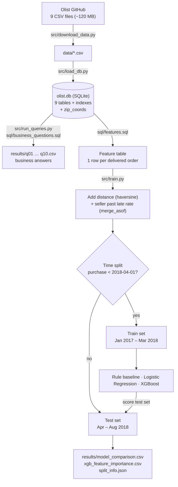
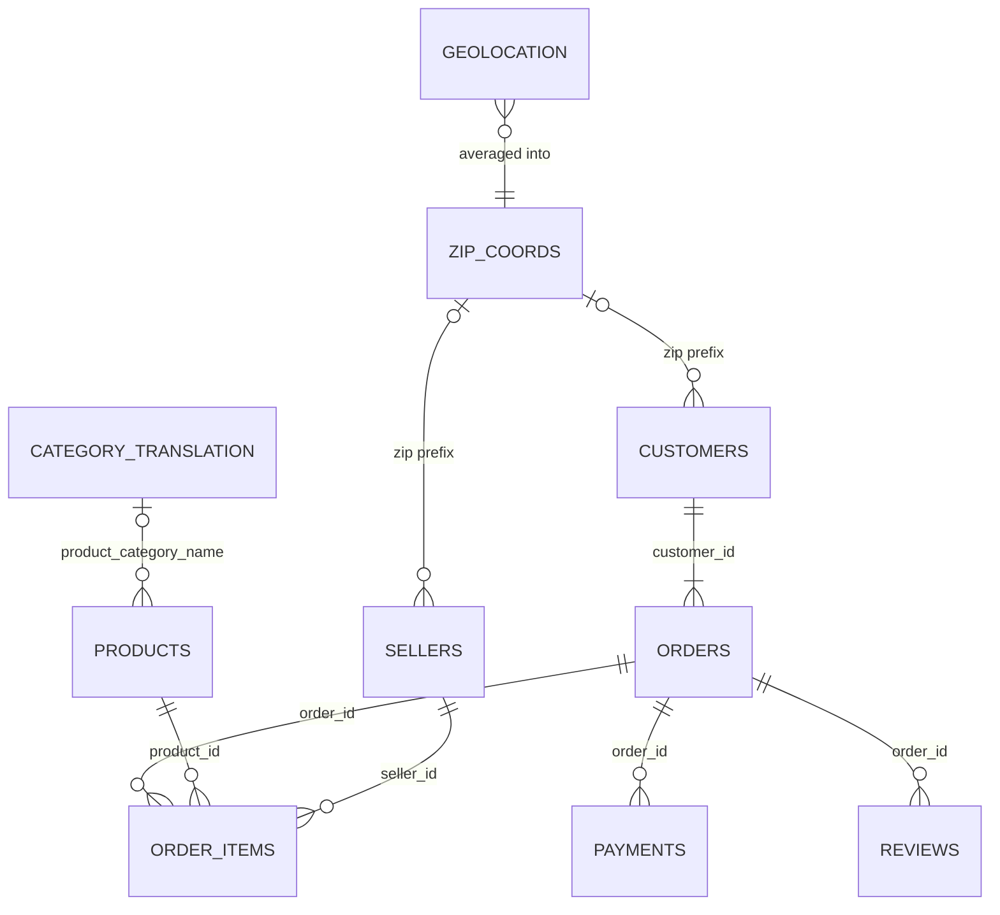

# E-commerce Delivery Analytics & Late-Delivery Prediction (SQL + ML)

Late deliveries are the biggest driver of bad reviews on Olist, a Brazilian e-commerce marketplace.
This project uses **SQL** to analyse ~100k real orders (2016–2018) across 9 linked tables, then builds a
**leakage-safe machine-learning model** that flags, at purchase time, the orders most likely to arrive late.

## Key findings

| Finding | Number | Query |
|---|---|---|
| Late orders get far worse reviews | avg **2.27★** late vs **4.29★** on time; **53.7%** of late orders get 1★ (vs 6.6%) | `q04` |
| Overall late-delivery rate | **6.8%** of delivered orders | `q05` |
| Cross-state shipping is riskier | **8.0%** late vs **4.5%** within the same state | `q05` |
| Lateness comes in network-wide spikes | **12.4%** late in Nov 2017 (Black Friday), **14.1%** Feb 2018, **19.0%** Mar 2018 | `q10` |
| Worst states | CE 13.8%, BA 12.2%, RJ 12.1% late (states with 1,000+ orders) | `q03` |
| Customers rarely come back | only **3.0%** of 94,990 customers ordered more than once | `q07` |
| Revenue concentration | top 10 categories = **62%** of revenue; health & beauty leads at 9.3% | `q02` |

## How the project works



1. **Download** – `download_data.py` fetches the 9 raw CSVs into `data/` (skips files already present).
2. **Load** – `load_db.py` writes each CSV to a SQLite table, adds indexes on the join keys, and builds
   `zip_coords` (one averaged lat/lng per zip-code prefix, collapsing ~1M geolocation rows to ~19k).
3. **Analyse** – `run_queries.py` splits `business_questions.sql` on its `-- name:` markers and saves each
   query's output to `results/<name>.csv`.
4. **Model** – `train.py` builds the feature table with `features.sql`, adds the distance and seller-history
   features in pandas, splits by purchase date, trains three approaches and scores them on the later period.

## Dataset: tables and how they connect

The [Olist dataset](https://github.com/olist/work-at-olist-data) is a real, anonymised snapshot of ~100k
orders placed on Brazilian marketplaces between 2016 and 2018.

| Table (in `olist.db`) | Rows | Grain (one row per…) | Key columns | What it holds |
|---|---:|---|---|---|
| `orders` | 99,441 | order | `order_id` (PK), `customer_id` | Status and the order timeline: purchase, approval, handed to carrier, delivered, **estimated (promised) delivery date** |
| `customers` | 99,441 | order's customer record | `customer_id` (PK), `customer_unique_id` | Zip prefix, city, state. A new `customer_id` is issued per order; `customer_unique_id` identifies the real person |
| `order_items` | 112,650 | item in an order | `order_id` + `order_item_id`, `product_id`, `seller_id` | Price, freight value, seller shipping deadline |
| `payments` | 103,886 | payment of an order | `order_id` + `payment_sequential` | Payment type (card, boleto, voucher…), instalments, amount. An order can be paid in several parts |
| `reviews` | 99,224 | review | `review_id`, `order_id` | 1–5 star score, optional comment, dates |
| `products` | 32,951 | product | `product_id` (PK) | Category (Portuguese), weight and dimensions, photo count |
| `sellers` | 3,095 | seller | `seller_id` (PK) | Zip prefix, city, state |
| `category_translation` | 71 | category | `product_category_name` | Portuguese → English category names |
| `geolocation` | 1,000,163 | zip prefix × coordinate sample | `geolocation_zip_code_prefix` | Lat/lng samples; many rows per prefix |
| `zip_coords` *(built by `load_db.py`)* | 19,015 | zip prefix | `zip_prefix` | Average lat/lng per prefix, used for customer–seller distance |



**How the joins work in practice**
- `orders` is the hub: every other table reaches it through `order_id` (items, payments, reviews) or
  `customer_id` (customers).
- **Sellers and products are only linked to orders through `order_items`.** An order with items from two
  sellers has two seller rows, which is why the SQL aggregates per order (`GROUP BY order_id`) before counting
  orders, e.g. `cross_state = MAX(seller_state <> customer_state)` in `q05`.
- Orders with several payments or several items would be double-counted by a naive join, so queries either
  aggregate first (CTEs `items`, `pay` in `features.sql`) or use `COUNT(DISTINCT order_id)`.
- Location data has no foreign key: customers and sellers join to `zip_coords` on the 5-digit zip prefix.
  A few prefixes are missing (279 customers, 8 sellers), so their coordinates and `distance_km` are NULL;
  Logistic Regression imputes the median and XGBoost handles missing values natively.
- Not every order has items (775 canceled/unavailable orders have none), and 610 products have no category,
  hence the `LEFT JOIN`s and `COALESCE(..., 'unknown')`.
- "Late" is defined everywhere as `date(order_delivered_customer_date) > date(order_estimated_delivery_date)`.

## SQL (sql/business_questions.sql)

Ten business questions, each saved to `results/<name>.csv`:

1. Monthly revenue, month-over-month growth and running total (`LAG`, `SUM() OVER`)
2. Top 10 categories and their share of revenue (window `SUM() OVER ()`)
3. Late rate, actual vs promised delivery days by state (`CASE`, `GROUP BY`, `HAVING`)
4. Review score for late vs on-time orders (CTE + join)
5. Late rate for cross-state vs same-state shipments (order-level aggregation)
6. Top 3 sellers by revenue within each major state (`DENSE_RANK() OVER (PARTITION BY ...)`)
7. Repeat-customer rate (`customer_unique_id`)
8. Payment-method mix (scalar subquery for share)
9. Delivered orders without a review (anti-join: `LEFT JOIN ... IS NULL`)
10. Monthly late-delivery rate

The model's feature table is also built in SQL (`sql/features.sql`): one row per delivered order with
promise window, approval delay, basket size, price, freight, weight/volume, category, payment,
customer/seller states and coordinates.

## Machine learning (src/train.py)

**Target:** `is_late` = delivered after the promised date (6.8% overall, so the classes are imbalanced).

**Leakage controls**
- Only information available at purchase/approval time is used; carrier and delivery timestamps are excluded.
- *Seller past late rate* is computed only from that seller's orders **delivered before** each purchase
  (`pandas.merge_asof`), smoothed toward the training-period average for new sellers.
- **Time-based split:** train on purchases Jan 2017 – Mar 2018 (64,053 orders, 8.0% late),
  test on Apr – Aug 2018 (32,150 orders, 4.4% late).

**Results on the time-based test set**

| Approach | ROC-AUC | PR-AUC | Top-10% flagged: precision | Top-10% flagged: recall |
|---|---|---|---|---|
| Rule: cross-state + shortest promise | 0.59 | 0.061 | 7.0% | 15.9% |
| Logistic Regression (scaled, one-hot, class weights) | 0.70 | 0.094 | 10.8% | 24.3% |
| **XGBoost** (scale_pos_weight, depth 4) | **0.72** | **0.119** | **12.9%** | **29.2%** |
| XGBoost on a *random* split (for contrast) | 0.78 | 0.260 | 26.9% | 39.7% |

- PR-AUC 0.119 is **2.7×** the 4.4% base rate. Flagging the riskiest 10% of orders catches **29%** of late
  orders, **2.9×** better than flagging at random.
- The random split looks much better only because orders from the same disrupted months fall in both train
  and test, so the model memorises *when* disruptions happened. That is a time leak, so the time-based
  numbers are the honest estimate.

## What it means for the business

- Late delivery is the main lever on customer satisfaction (2.27★ vs 4.29★).
- Much of the lateness comes from **network-wide shocks** (Black Friday, Feb–Mar 2018). Distance and
  cross-state status add only modest signal once the promised date is set, because the promise already
  accounts for distance (correlation 0.52; cross-state orders are promised 27.1 days vs 17.5 same-state).
  In the XGBoost model the strongest signals are the customer's state (SP, RJ) and purchase month
  (`results/xgb_feature_importance.csv`).
- Recommended actions: (1) use the model to send proactive delay messages or pick faster carriers for the
  riskiest ~10% of orders; (2) add capacity monitoring and alerting ahead of peak periods, which a per-order
  model cannot foresee; (3) review promise windows for high-late states such as CE, BA and RJ.

## Run it

```bash
pip install -r requirements.txt
python src/download_data.py     # ~120 MB of CSVs from the official Olist GitHub
python src/load_db.py           # builds olist.db (SQLite) with indexes
python src/run_queries.py       # runs the 10 SQL questions -> results/*.csv
python src/train.py             # builds features in SQL, trains, evaluates -> results/
```

SQLite date functions used here have MySQL equivalents: `strftime('%Y-%m', d)` → `DATE_FORMAT(d, '%Y-%m')`,
`julianday(a) - julianday(b)` → `DATEDIFF(a, b)`.

## Limitations and next steps

- Network-wide disruptions are not predictable from order attributes; adding external signals
  (holiday calendar, regional carrier load, weather) is the natural next step.
- Probabilities are not calibrated; calibrate before using them as risk scores.
- Results were produced with the exact library versions in `requirements.txt`; other versions
  (especially of xgboost) can shift the metrics slightly.
- Data: [Olist Brazilian E-Commerce Public Dataset](https://github.com/olist/work-at-olist-data) (CC BY-NC-SA 4.0).
